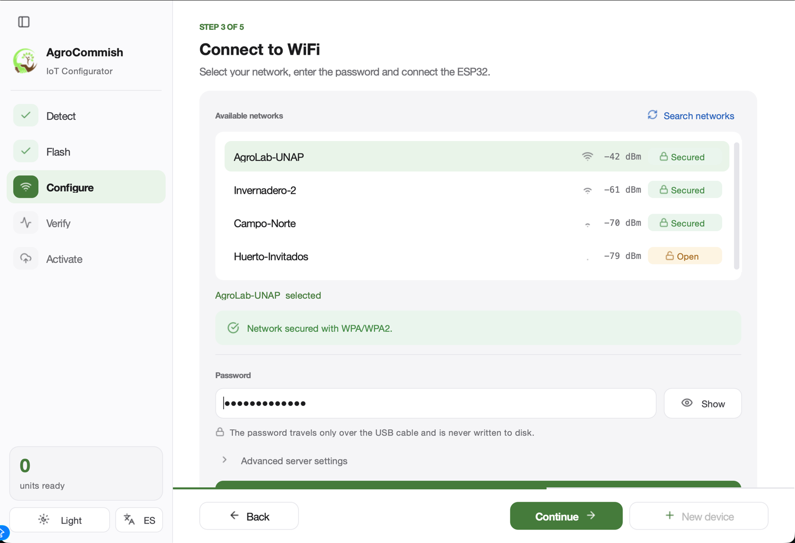
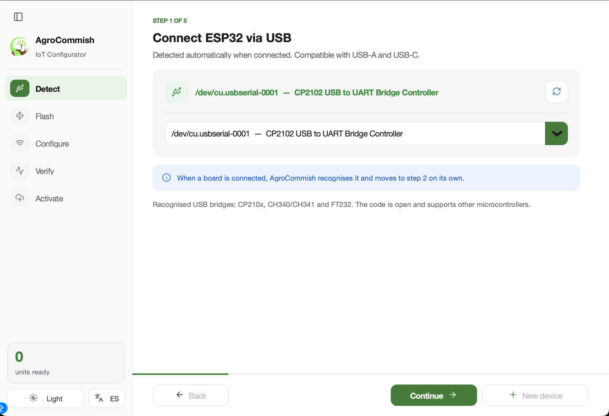
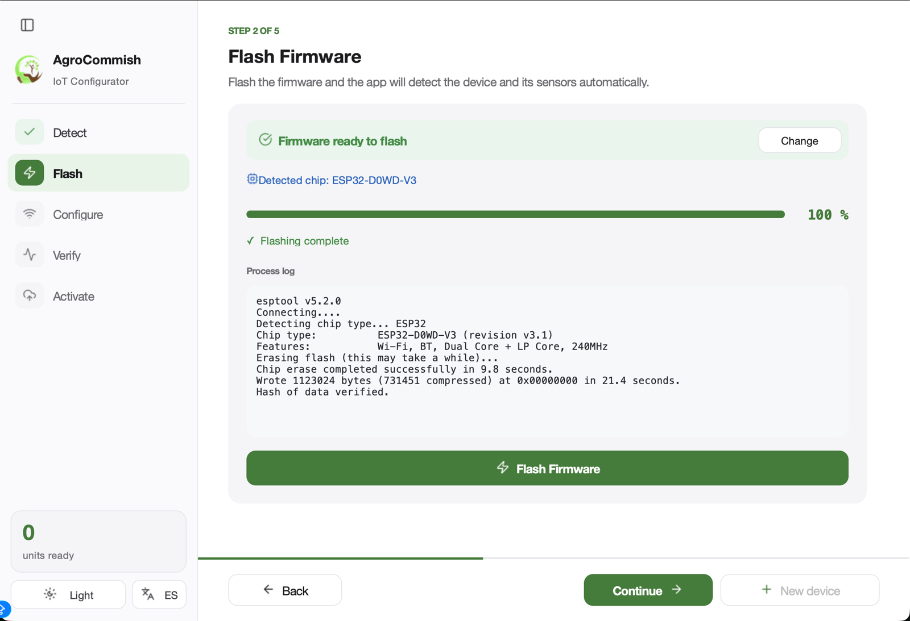
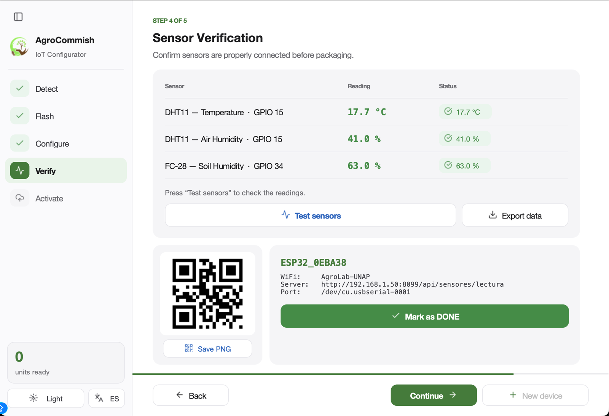
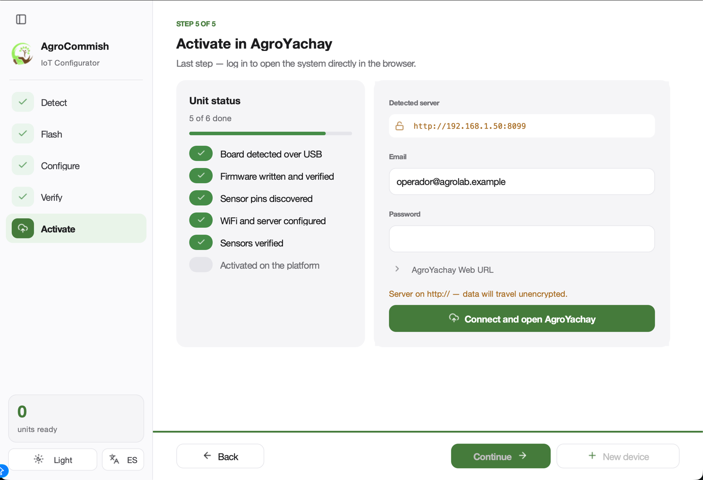
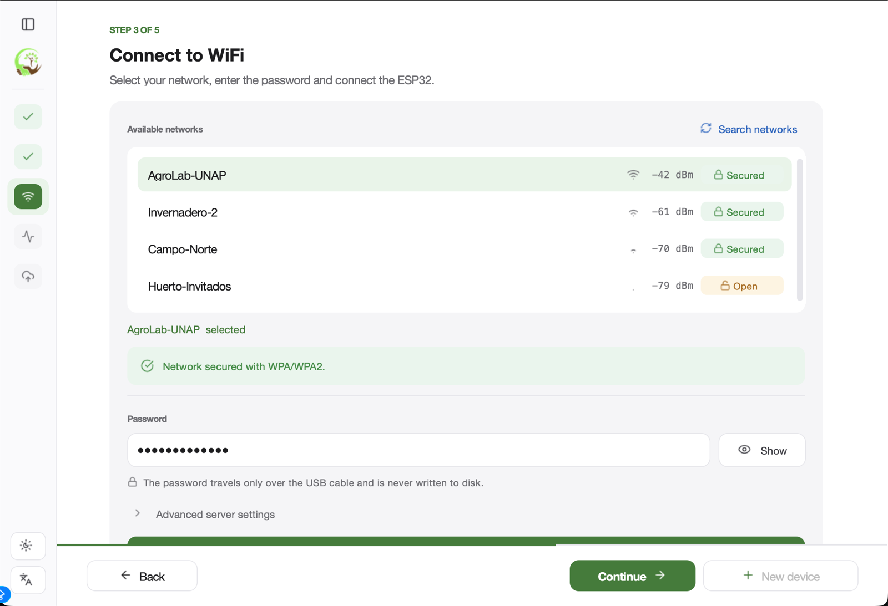
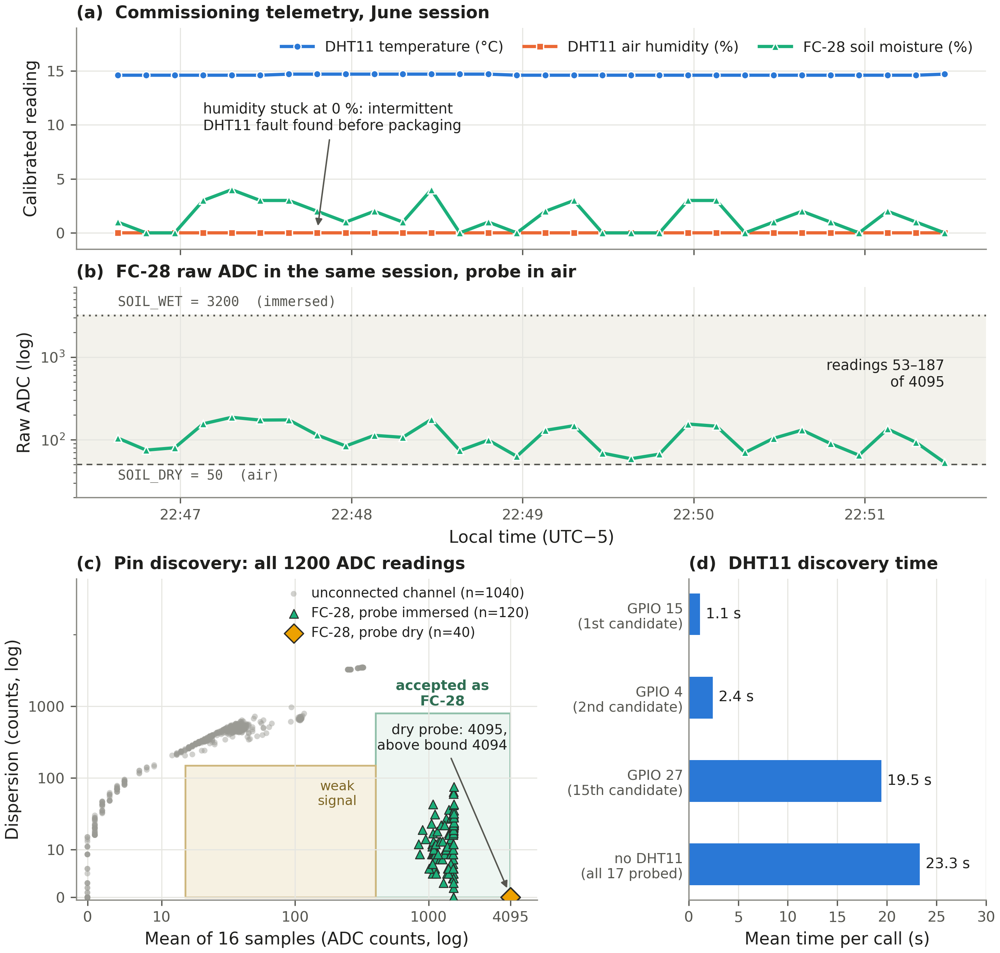
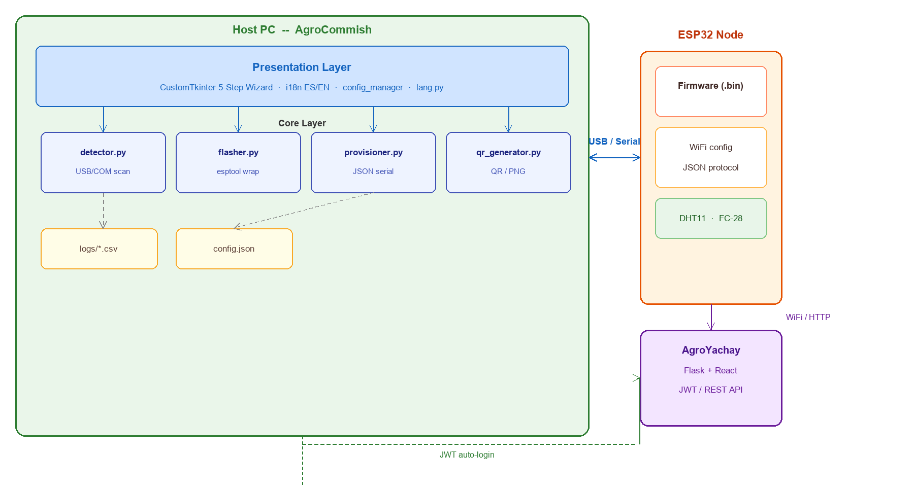

<div align="center">


# AgroCommish

### Plug-and-play commissioning of ESP32 agricultural sensor nodes, from bare board to cloud

[](https://github.com/Andre031222/agrocommish/releases/latest)
[](https://doi.org/10.5281/zenodo.20655609)
[](LICENSE)
[](https://github.com/Andre031222/agrocommish/actions/workflows/ci.yml)
[](#features)
<br>


</div>

> [!NOTE]
> **Español** — La documentación en español está en [`docs/README.es.md`](docs/README.es.md). La interfaz cambia entre español e inglés sin reiniciar.

AgroCommish is a desktop wizard that takes an ESP32 board from bare hardware to a flashed, provisioned, tested and cloud-registered sensor node. A technician plugs the board in and follows five steps; the tool detects the USB bridge, writes the firmware, finds the GPIO pins where the sensors are wired, sends the WiFi and server settings, checks every sensor reading and hands the node over to the cloud platform. No terminal, scripts or manual pin tables are needed.

<picture>
  <source media="(prefers-color-scheme: dark)" srcset="docs/img/step3-dark.png">
  
</picture>

* * *

## Contents

1. [Install](#install)
2. [Why it exists](#why-it-exists)
3. [Features](#features)
4. [The five steps](#the-five-steps)
5. [Hardware and other microcontrollers](#hardware-and-other-microcontrollers)
6. [Cloud platform](#cloud-platform)
7. [Security](#security)
8. [Validation](#validation)
9. [Architecture](#architecture)
10. [Development](#development)
11. [Citation](#citation)
12. [License and third-party assets](#license-and-third-party-assets)

## Install

| Option | How |
|---|---|
| Windows 10/11, no Python | Download `AgroCommish.exe` and `firmware.bin` from the [latest release](https://github.com/Andre031222/agrocommish/releases/latest), put `firmware.bin` in a `firmware` folder next to the executable and run it. |
| From source (Windows, macOS, Linux) | `pip install -r requirements.txt` then `python app.py` |
| Look around without a board | `python app.py --demo` fills every step with illustrative values. |

On Windows, the USB driver for the board's bridge (CP210x or CH340) must be installed.

## Why it exists

Commissioning a low-cost agricultural sensor node usually spreads across several tools: `esptool` on the command line, a script for the WiFi credentials, a serial monitor to read the sensors and a web form to register the device. Each hand-over is a chance to flash the wrong image, mistype the server address or ship a node with a loose sensor. AgroCommish puts the whole sequence in one guided window, so that a field technician with no programming background can prepare a batch of nodes and catch wiring faults before they leave the workshop.

## Features

| | |
|---|---|
| **Plug-and-play** | The board is recognised on connection and the wizard moves to the next step on its own. |
| **Pin auto-discovery** | After flashing, the firmware probes 17 GPIOs for the DHT11 and the six ADC1 channels for the FC-28, and stores the pin map on the device. |
| **Verification that works offline** | Sensor readings are checked over USB first, so a node can be tested even when the backend is down. |
| **Network pre-flight** | The server address is tested before it is written to the device, and the workstation's real LAN address is suggested when it fails. |
| **WiFi security checks** | Each network is labelled as secured or open, WPA/WPA2 passwords are checked for length, and the password is cleared after use. |
| **Unit checklist** | A live checklist tracks detection, flashing, pins, WiFi, sensors and activation for every unit. |
| **Light and dark themes** | System, light (white) or dark (black) appearance, a collapsible sidebar and vector icons. |
| **Audit trail** | Every milestone is written to a timestamped CSV log; telemetry can be exported to CSV and the device ID printed as a QR label. |

## The five steps

| Step | What happens | Screen |
|---|---|---|
| 1 · Detect | USB ports are polled every second; CP210x, CH340/CH341 and FT232 bridges are recognised automatically. |  |
| 2 · Flash | Full chip erase and firmware write with esptool; the chip type is shown, then the sensor pins are discovered. |  |
| 3 · Configure | On-device WiFi scan with signal and security, password checks and server pre-flight; optional calibration. |  |
| 4 · Verify | DHT11 and FC-28 readings are checked against physical and agronomic ranges; QR label with the device ID. |  |
| 5 · Activate | Login to the cloud platform and automatic browser session; the unit checklist closes the batch entry. |  |

<picture>
  <source media="(prefers-color-scheme: dark)" srcset="docs/img/sidebar-collapsed-dark.png">
  
</picture>

## Hardware and other microcontrollers

The reference node is an ESP32 (NodeMCU-32S, ESP32-WROOM-32) with a DHT11 temperature and humidity sensor and an FC-28 resistive soil-moisture probe, powered at 3.3 V.

| Item | Default |
|---|---|
| DHT11 data | GPIO 15 (auto-discovered) |
| FC-28 analogue output | GPIO 34 (auto-discovered, ADC1 only) |
| USB bridges recognised | CP210x, CH340/CH341, FT232 |

AgroCommish is open source and is not tied to this board or sensor pair. `esptool` detects the chip automatically, the JSON-over-serial protocol is hardware-agnostic, and new sensors are added by extending the firmware command set and `SENSOR_SPECS` in [`core/provisioner.py`](core/provisioner.py). The firmware source is in [`firmware/src/agrovision_provisioning`](firmware/src/agrovision_provisioning); build it with Arduino-ESP32 3.3 and ArduinoJson 7 to target another ESP32 variant.

## Cloud platform

The reference platform is **[AgroYachay](https://agroyachay.ginit.dev)**, an open-source IoT and decision-support system for Andean smallholders ([SoftwareX 36, 103037](https://doi.org/10.1016/j.softx.2026.103037)). It receives the node readings, links each device to its owner and serves the dashboard opened in step 5.

The platform is a setting, not a dependency. Any backend that accepts the JSON readings at the ingestion endpoint and exposes `POST /api/auth/login` returning a token can be used; change the server address under *Advanced server settings* in step 3 and the web address in step 5.

## Security

AgroCommish assumes a trusted workshop: the operator holds the board and controls the computer.

| Exposure | How it is handled |
|---|---|
| WiFi password over USB | Sent only over the point-to-point USB cable, never written to disk, cleared from the form after use. |
| Open WiFi networks | Labelled as *Open* and flagged before use. |
| Telemetry over `http://` | A persistent warning is shown before activation. |
| Platform token | Passed to the browser in a URL fragment, so it does not reach server logs; it remains in the local browser history, which is why the tool should not be used on an untrusted computer. |

## Validation

The pin-discovery routine was run 200 times on four NodeMCU-32S boards under six wiring conditions (95 % Clopper–Pearson intervals).

| Condition | Trials | DHT11 | FC-28 |
|---|---:|---|---|
| Probe immersed, default wiring | 80 | 80/80 | 80/80 |
| DHT11 moved to GPIO 4 / GPIO 27 | 40 | 40/40 | 40/40 |
| FC-28 disconnected | 20 | 20/20 | 20/20 absent |
| No sensors connected | 20 | 20/20 absent | 20/20 absent |
| Probe dry, in air | 40 | 40/40 | 0/40 |
| **Total** | **200** | **200/200** (98.2–100 %) | **160/200** |

No false positive occurred. The only failure mode is a dry probe, which rests at a supply rail and cannot be told apart from an unconnected input; the wizard asks the operator to insert the probe into moist soil. Five end-to-end runs on one board took a median of 51.0 s per unit. All datasets are in [`data/`](data/) and the scripts that produced them in [`tools/`](tools/).



## Architecture



```
app.py                      Entry point (python app.py [--demo])
ui/
  window.py                 Window, sidebar, navigation, theme and language
  theme.py                  Colour tokens (light/dark), fonts and easing
  widgets.py                Buttons, cards, banners, toasts and splash screen
  icons.py                  Tinted vector icons
  demo.py                   Demonstration data
  steps/                    detect · flash · configure · verify · activate
core/
  detector.py               USB/COM enumeration and bridge identification
  flasher.py                esptool wrapper with progress parsing
  provisioner.py            JSON-over-serial protocol and sensor validation
  network.py                Reachability checks and WiFi password rules
  config_manager.py         Session settings (config.json)
  lang.py                   Spanish and English strings
  qr_generator.py           QR labels
firmware/src/               ESP32 firmware source
tools/                      Benchmark, validation, capture and icon scripts
data/                       Benchmark, telemetry and pin-discovery datasets
```

## Development

```bash
python -m venv .venv && source .venv/bin/activate
pip install -r requirements.txt pytest pyflakes
python -m pyflakes app.py ui core tools tests
python -m pytest tests/ -v
python app.py --demo
```

| Tool | Purpose |
|---|---|
| `tools/validar_deteccion_pines.py` | Repeated pin-discovery trials against declared ground truth |
| `tools/benchmark_comisionado.py` | Unattended end-to-end timing |
| `tools/capturar_datos.py` | USB telemetry capture to CSV |
| `tools/medir_tiempos.py` | Step times from the session log |
| `tools/capture_screenshots.py` | Screenshots of every step (`docs/img`, light or dark) |
| `tools/render_icons.py` | Rasterises the SVG icons (needs `cairosvg`) |

The Windows executable is built with `pyinstaller AgroCommish.spec`; the release workflow builds it on every version tag.

## Citation

```bibtex
@software{agrocommish,
  author  = {Vilca-Solorzano, Richar Andre and Yana-Yucra, Dina Maribel and
             Quispe-Vargas, Renato and Iba{\~n}ez-Quispe, Vladimiro and
             Torres-Cruz, Fred},
  title   = {AgroCommish: A Plug-and-Play Desktop Tool for End-to-End
             Manufacturing and Commissioning of ESP32-Based Agricultural
             IoT Sensor Nodes},
  year    = {2026},
  version = {1.2.0},
  doi     = {10.5281/zenodo.20655609},
  url     = {https://github.com/Andre031222/agrocommish}
}
```

The DOI above always resolves to the latest version; [`CITATION.cff`](CITATION.cff) feeds GitHub's *Cite this repository* button.

## License and third-party assets

AgroCommish is released under the [MIT License](LICENSE). Icons are from [Lucide](https://lucide.dev) under the ISC License ([`assets/icons/LICENSE`](assets/icons/LICENSE)). `esptool` is called as an external program and keeps its own GPL-2.0 licence.

<div align="center">
<sub>Universidad Nacional del Altiplano (UNAP) · Puno, Peru</sub>
</div>
