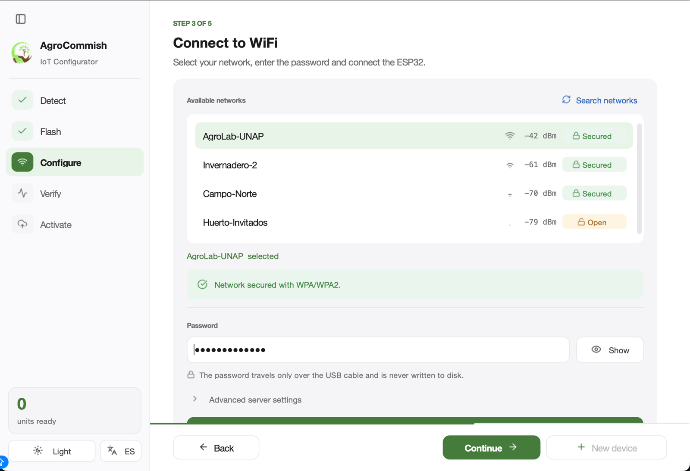

<div align="center">


# AgroCommish

### Puesta en marcha plug-and-play de nodos agrícolas ESP32, de la placa vacía a la nube

</div>

AgroCommish es un asistente de escritorio que lleva una placa ESP32 desde cero hasta un nodo de sensores grabado, configurado, probado y registrado en la nube. El técnico conecta la placa y sigue cinco pasos: la herramienta detecta el puente USB, graba el firmware, encuentra los pines donde están cableados los sensores, envía la red WiFi y el servidor, comprueba cada lectura y entrega el nodo a la plataforma. No hace falta terminal, scripts ni tablas de pines.

<picture>
  <source media="(prefers-color-scheme: dark)" srcset="img/step3-dark.png">
  
</picture>

## Instalar

| Opción | Cómo |
|---|---|
| Windows 10/11, sin Python | Descarga `AgroCommish.exe` y `firmware.bin` de la [última versión](https://github.com/Andre031222/agrocommish/releases/latest), deja `firmware.bin` en una carpeta `firmware` junto al ejecutable y ábrelo. |
| Desde el código (Windows, macOS, Linux) | `pip install -r requirements.txt` y luego `python app.py` |
| Verla sin placa | `python app.py --demo` llena cada paso con valores de ejemplo. |

En Windows hace falta el driver del puente USB de la placa (CP210x o CH340).

## Los cinco pasos

| Paso | Qué hace |
|---|---|
| 1 · Detectar | Revisa los puertos USB cada segundo y reconoce los puentes CP210x, CH340/CH341 y FT232. Al conectar una placa pasa solo al paso 2. |
| 2 · Grabar | Borra la memoria y graba el firmware con esptool, muestra el chip detectado y busca los pines del DHT11 y del FC-28. |
| 3 · Configurar | Escanea las redes desde la placa con su señal y seguridad, valida la contraseña, comprueba el servidor y permite calibrar. |
| 4 · Verificar | Compara las lecturas con rangos físicos y agronómicos y genera la etiqueta QR del dispositivo. |
| 5 · Activar | Inicia sesión en la plataforma y abre el navegador con la sesión activa; la lista de la unidad queda completa. |

## Otros microcontroladores y otros sistemas

AgroCommish es de código abierto y no está atado a esta placa ni a estos sensores. esptool detecta el chip, el protocolo JSON por serie no depende del hardware y los sensores nuevos se agregan ampliando el firmware ([`firmware/src`](../firmware/src)) y `SENSOR_SPECS` en `core/provisioner.py`.

La plataforma de referencia es **[AgroYachay](https://agroyachay.ginit.dev)** ([SoftwareX 36, 103037](https://doi.org/10.1016/j.softx.2026.103037)), pero el servidor es un ajuste: sirve cualquier backend que reciba las lecturas JSON y ofrezca `POST /api/auth/login`.

## Seguridad

| Riesgo | Cómo se maneja |
|---|---|
| Contraseña WiFi | Viaja solo por el cable USB, no se guarda en disco y se borra del formulario al terminar. |
| Redes abiertas | Se marcan como *Abierta* y se avisa antes de usarlas. |
| Servidor `http://` | Aviso permanente antes de activar. |
| Token de la plataforma | Va en el fragmento de la URL y no llega a los registros del servidor; queda en el historial del navegador, por eso no conviene usar la herramienta en una computadora ajena. |

## Validación

En 200 pruebas sobre cuatro placas NodeMCU-32S, el DHT11 se detectó en todas (IC 95 %: 98,2–100 %) y no hubo falsos positivos. El FC-28 solo falla con la sonda seca, por eso el asistente pide insertarla en tierra húmeda. Los datos están en [`data/`](../data/) y los scripts en [`tools/`](../tools/).

## Desarrollo

```bash
pip install -r requirements.txt pytest pyflakes
python -m pyflakes app.py ui core tools tests
python -m pytest tests/ -v
python app.py --demo
```

La documentación completa, la arquitectura y la cita están en el [README principal](../README.md).

<div align="center">
<sub>Universidad Nacional del Altiplano (UNAP) · Puno, Perú · Licencia MIT</sub>
</div>
